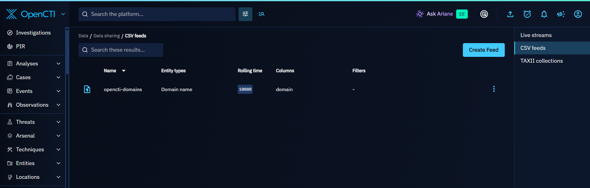
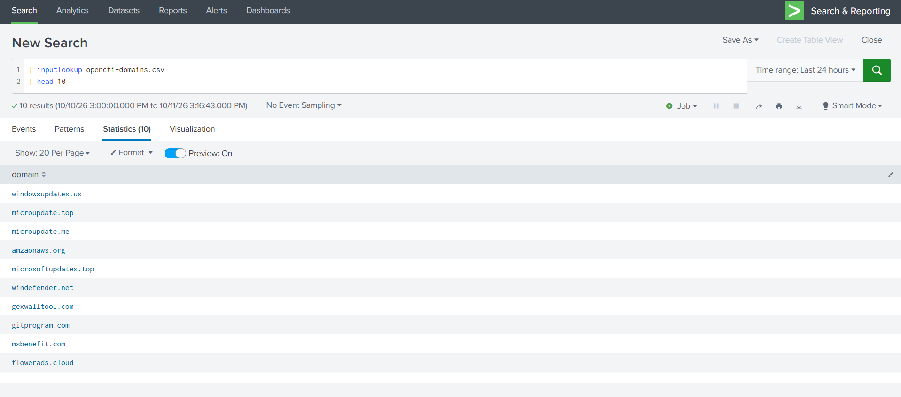
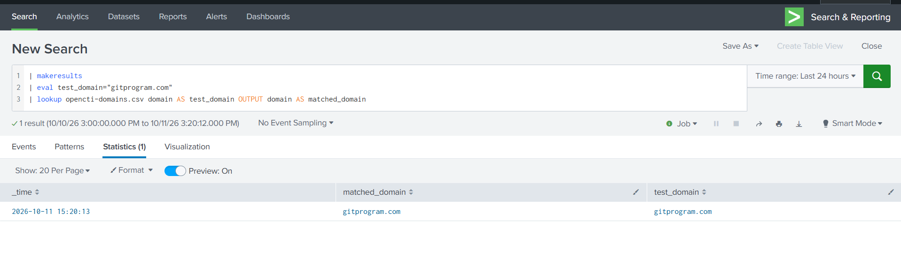
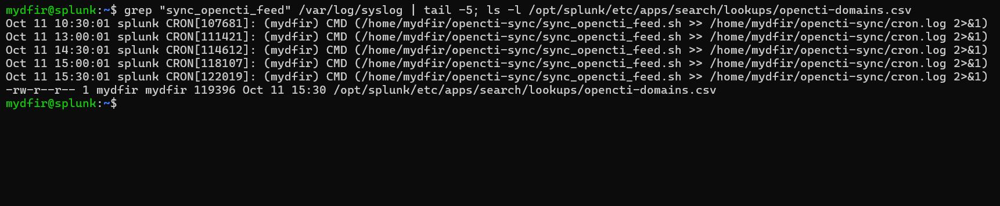

# OpenCTI → Splunk Threat Intelligence Integration

A practical SOC threat-intelligence pipeline that collects threat data from AlienVault OTX through OpenCTI and makes domain indicators available to Splunk Free for IOC enrichment and investigation.

## Project Goal

SOC analysts frequently need to compare activity in their environment against known malicious infrastructure.

This project builds a small threat-intelligence pipeline where:

1. AlienVault OTX provides external threat intelligence.
2. OpenCTI collects and manages the intelligence.
3. OpenCTI exposes selected domain indicators through a CSV feed.
4. A Bash sync script retrieves the feed automatically.
5. cron runs the sync every 30 minutes.
6. Splunk Free loads the data as a lookup for IOC enrichment.

## Architecture

```text
AlienVault OTX
      |
      v
   OpenCTI
      |
      | CSV Threat Feed
      v
 Linux Sync Script
      |
      | cron every 30 minutes
      v
 Splunk CSV Lookup
      |
      v
IOC Enrichment / SOC Investigation
```

## Why This Architecture

The original workflow I studied used an OpenCTI-to-Splunk connector with Splunk authentication tokens and KV Store integration.

My lab uses **Splunk Free**, where that authentication-token workflow was not available.

Instead of abandoning the integration, I adapted the design:

```text
Original:
OpenCTI → Splunk Connector → Authentication Token → KV Store

Lab-compatible:
OpenCTI → CSV Feed → Bash Sync Script → Splunk CSV Lookup
```

This preserved the core SOC objective: making OpenCTI indicators available inside Splunk for enrichment.

## Lab Components

| Component | Purpose |
|---|---|
| AlienVault OTX | Threat-intelligence source |
| OpenCTI | Threat-intelligence platform |
| Splunk Free | SIEM and IOC enrichment |
| Ubuntu Server | Linux lab systems |
| Docker | OpenCTI stack |
| Bash | Feed synchronization |
| cron | Scheduled refresh |
| VMware | Virtual lab networking |

## OpenCTI CSV Feed

The OpenCTI feed is configured for `Domain-Name` entities with a rolling seven-day window.

Example:

```csv
domain
gitprogram.com
msbenefit.com
flowerads.cloud
adsmachineio.com
windows-accs.live
```

The seven-day rolling window avoids exporting the entire historical CTI database into the lab.

## Splunk Lookup

The synchronized lookup is stored at:

```text
/opt/splunk/etc/apps/search/lookups/opencti-domains.csv
```

Basic validation:

```spl
| inputlookup opencti-domains.csv
| head 10
```

IOC match test:

```spl
| makeresults
| eval test_domain="gitprogram.com"
| lookup opencti-domains.csv domain AS test_domain OUTPUT domain AS matched_domain
```

A successful match confirms Splunk can enrich observed domains against OpenCTI threat intelligence.

## Automation

The synchronization script is located in:

```text
scripts/sync_opencti_feed.sh
```

Example cron schedule used in the lab:

```cron
*/30 * * * * /home/mydfir/opencti-sync/sync_opencti_feed.sh >> /home/mydfir/opencti-sync/cron.log 2>&1
```

The automated flow was verified by confirming the Splunk lookup file timestamp changed after a scheduled cron execution without a manual script run.

## Evidence and Validation

The screenshots below document the working lab pipeline.

### 1. OpenCTI CSV threat feed

The OpenCTI `opencti-domains` feed exports Domain Name entities through a seven-day rolling CSV feed.



### 2. Splunk lookup ingestion

The `inputlookup` query returns domain values from the synchronized CSV file.



### 3. IOC enrichment validation

A **simulated test event** containing `gitprogram.com` successfully matches the OpenCTI lookup. This validates lookup matching; it does **not** represent a confirmed real-world network detection.



### 4. Automated synchronization proof

The cron log shows scheduled execution at 15:30 on October 11, and the Splunk lookup file has a corresponding 15:30 modification timestamp. Together, these provide evidence of a successful scheduled refresh.



## SOC Use Case

A threat-intelligence match is an investigation pivot, not proof of compromise.

```text
IOC Match
   ↓
Which host?
   ↓
Which user/process?
   ↓
When?
   ↓
What happened before?
   ↓
What happened afterward?
   ↓
Scope
   ↓
Conclusion
```

Conceptual enrichment pattern:

```spl
<network or DNS events>
| lookup opencti-domains.csv domain AS observed_domain OUTPUT domain AS threat_match
| where isnotnull(threat_match)
```

## Major Troubleshooting Lessons

This project required troubleshooting across multiple layers:

- VMware networking between Splunk and OpenCTI
- Linux disk/LVM expansion
- OpenCTI memory pressure
- Redis RDB corruption
- AlienVault timestamp parsing
- Excessive historical OTX ingestion
- RabbitMQ queue inspection and targeted purge
- Legacy Docker Compose `ContainerConfig` errors
- Splunk Free authentication-token limitations
- cron automation validation

See [docs/troubleshooting.md](docs/troubleshooting.md) for the detailed breakdown.

## Skills Demonstrated

- Threat intelligence integration
- OpenCTI
- AlienVault OTX
- Splunk lookups
- IOC enrichment
- Bash scripting
- cron automation
- Linux administration
- Docker troubleshooting
- RabbitMQ troubleshooting
- Redis troubleshooting
- VMware networking
- SOC investigation workflows
- Adapting integrations around licensing constraints

## Repository Structure

```text
.
├── README.md
├── architecture/
│   └── README.md
├── configs/
│   └── alienvault-connector.example.yml
├── docs/
│   └── troubleshooting.md
├── scripts/
│   └── sync_opencti_feed.sh
├── splunk/
│   └── example-searches.md
└── screenshots/
    └── README.md
```

## Security Notes

This repository intentionally excludes:

- API keys
- OpenCTI tokens
- Splunk authentication tokens
- encryption keys
- passwords
- `.env` contents

Use placeholders in public configuration examples and review screenshots before publishing them.

## Future Improvements

- Add IP-address and file-hash feeds
- Add CSV header validation before replacement
- Use atomic file replacement
- Add structured logging
- Separate lookups by IOC type
- Add IOC expiration handling
- Add dashboards for CTI matches
- Build correlation searches
- Add additional CTI sources
